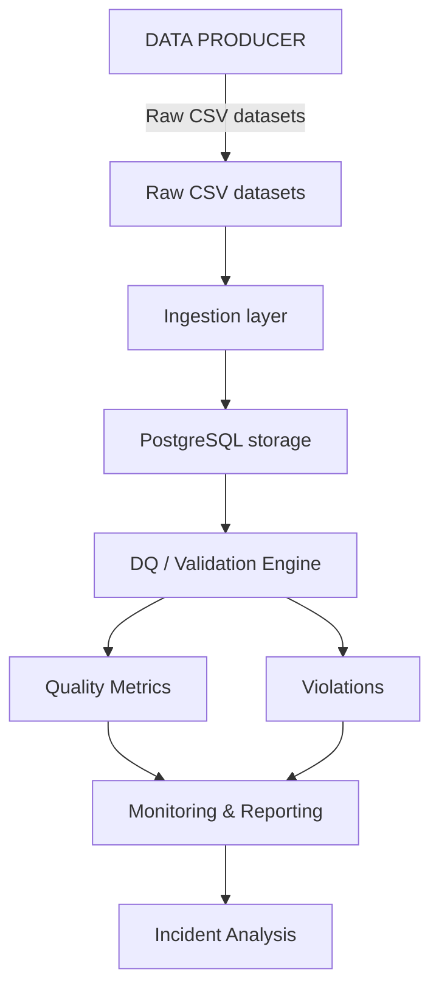

# Data Quality Architecture Documentation

--- 

## 1. Overall Architecture

--- 

## 2. Raw CSV Datasets

- **Description**: Represents the external source system.
- **Sources in a Real Company**:
  - Application database
  - API
  - SFTP
  - Another company's system
  - Object storage
  - Transactional database

--- 

## 3. Ingestion Layer

- **Responsibility**: 
  - Read source
  - Basic parsing
  - Load data

--- 

## 4. PostgreSQL

- **Purpose**: 
  - Serves as operational metadata and test environment
  - Contains:
    - Business data
    - Data Quality (DQ) metadata

--- 

## 5. Validation Engine

-## Validation Execution

The validation framework separates **validation logic** from **validation orchestration**.

### ValidationRule — validation abstraction

`ValidationRule` is an abstract base class that defines the common interface for all validation rules.

Each concrete rule:
- Is configured with its target column and rule-specific parameters.
- Implements the `validate(data, dataset)` method.
- Receives a Pandas DataFrame and dataset identifier.
- Returns a `ValidationResult` describing the validation outcome.

Concrete implementations include:
- `NotNullRule`
- `RangeRule`
- `AcceptedValuesRule`
- `RegexRule`

Each rule is responsible only for evaluating its own validation condition and producing a result. It does not manage execution of other rules.

### ValidationRunner — orchestration

`ValidationRunner` is a concrete orchestration class responsible for executing a configured collection of validation rules.

Its responsibilities are:

1. Accept an ordered collection of `ValidationRule` instances during initialization.
2. Reject an empty rule collection.
3. Receive a DataFrame and dataset identifier when validation is requested.
4. Execute each configured rule through the common `ValidationRule` interface.
5. Collect the resulting `ValidationResult` objects.
6. Return the results in the same order as the configured rules.

The runner depends on the abstract `ValidationRule` interface rather than specific rule implementations. This allows new validation rules to be introduced without modifying the runner.

### Execution flow

The validation process follows this sequence:

1. Configure individual validation rules with their respective parameters.
2. Register the rules in a `ValidationRunner`.
3. Pass a DataFrame and dataset identifier to `run_validation()`.
4. The runner invokes `validate()` on each configured rule.
5. Each rule evaluates the data and returns a `ValidationResult`.
6. The runner collects all results and returns them to the caller.

A failed validation does not interrupt execution of subsequent rules. Unexpected exceptions propagate to the caller.

### Design boundaries

The responsibilities of the two components remain deliberately separated:

| Component | Responsibility | Does not handle |
|---|---|---|
| `ValidationRule` | Individual data-quality evaluation | Rule orchestration, persistence, reporting |
| `ValidationRunner` | Execution and collection of validation results | Rule implementation, data ingestion, persistence, monitoring |

The runner does not retain the DataFrame as instance state, mutate the input data, or persist validation results. Each execution creates a new results collection.

This separation provides a small, extensible validation engine that can later be integrated into a larger data pipeline and observability layer.
--- 

## 6. DQ Metrics

- **Purpose**: Measure data quality.

--- 

## 7. Monitoring

- **Description**: 
  - Moves the project from Data QA towards DataOps
  - **Monitored Aspects**:
    - Freshness
    - Pipeline duration
    - Row-count anomaly
    - Quality degradation

--- 

## 8. Incidents

- **Description**: Intentional introduction of failures for testing and validation.